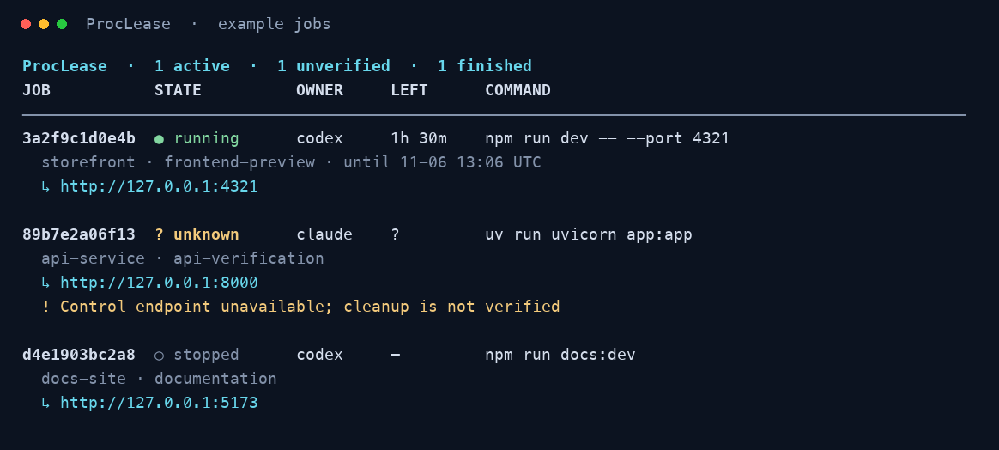

# ProcLease

Put an explicit lifetime on development processes started by coding agents.

ProcLease is a Rust CLI and a portable skill for Codex and Claude Code. Start a
foreground service with a deadline; inspect its status and bounded logs from later
tool calls; explicitly extend it or let it expire. Reading logs never renews it.

**Status:** experimental, MIT-licensed open source. Tested locally on macOS arm64
and Linux aarch64 in a non-root container. It is not published to a package
registry. Domain: `proclease.com`; no hosted service is required.

Source and issues: [jaredchu/proclease](https://github.com/jaredchu/proclease).

## Build

Install Git and a current stable Rust toolchain, then:

```sh
git clone https://github.com/jaredchu/proclease.git
cd proclease
cargo install --path . --locked
proclease --version
```

## Use

```sh
cd your-project
proclease run --owner claude --task preview --ttl 2h -- npm run dev
proclease list
proclease list --json
proclease list --json --resources
proclease list --all
proclease logs JOB_ID --tail 50
proclease extend JOB_ID --by 1h
proclease stop JOB_ID
proclease watch
proclease prune --dry-run
```

The table shows CPU/RSS usage, compact countdowns, state colors, project/task
details and preview URLs. It switches to a stacked layout in narrow terminals. Colors are automatic
for terminals; `NO_COLOR`, `TERM=dumb` or `--color never` disables them, and
`--color always` forces them. Redirected output and JSON stay uncolored by default.



A real disposable worker and synthetic history rows shown with
`proclease watch --all`; the default view briefly shows recently finished jobs
before hiding them.

All commands accept `--json`. `watch --once --json` produces one bounded snapshot.
The JSON envelope has `schema_version: 1`; command errors return a nonzero exit
code and an `error` field when `--json` was supplied. Argument-parser errors use
Clap's standard stderr output and exit code 2.

Commands are argument vectors after `--`, without implicit shell evaluation.
The service inherits the launching caller's directory, environment and execution
restrictions. Standard input is closed; interactive programs are not supported.
`--owner`, `--task`, `--name` and `--url` are declared metadata. A `running` state
means the program spawned, not that a web endpoint is ready.

## Resource usage

Human `list` and `watch` show CPU percentage and resident memory (RSS) for the
service and children still in its managed process group. ProcLease's two
supervisors are excluded. CPU **100% means one core**; totals can exceed 100%.
RSS adds each process's resident bytes, so shared pages may be counted more than
once. Children that leave the group are outside these measurements.

One-shot views take two samples roughly 200ms apart. Live watch warms up on its
first frame; `…` means CPU is still sampling and `—` means unavailable. Finished
or unverified jobs do not retain live metrics. Counters are read on demand,
without saving a usage history, changing deadlines or starting a monitoring daemon.

Ordinary JSON stays unchanged and avoids the sampling delay. Request metrics with
`proclease list --json --resources` or
`proclease watch --once --json --resources`. Each job then includes `resources`
with `cpu_percent`, `memory_rss_bytes`, `processes` and `sample_interval_ms`;
unavailable values are `null`. An unavailable group has `resources: null`.

## Lease rules

- Default duration: **2h**. Maximum total lifetime: **24h from creation**.
- `extend --by 1h` adds one hour to the current deadline, atomically.
- Listing, reading logs and opening the terminal view do not renew a lease.
- On expiry, stop or command exit, the supported process group receives TERM,
  followed by KILL after a default two-second grace. `--grace` can be set up to 10s.
- Elapsed wall time includes sleep. An overdue job is stopped when execution
  resumes. No process can enforce a deadline while the machine is powered off.
- Killing either supervision process triggers fail-closed group cleanup. There is
  no automatic restart or recovery that resumes a service after supervision fails.
- Each run is a separate job. Assign `--key REQUEST_ID` on the **initial run** to
  make retries idempotent for that command, directory, environment and launch
  policy. Reuse the same key unchanged. Adding a key later does not identify an
  earlier keyless job. A retained retry never renews or resurrects a job; a different
  context is rejected. Empty interrupted-launch reservations and those containing
  only private generated atomic-write temporary files are ignored without deleting
  state; unreadable/ambiguous launch metadata still fails closed.
- Stop during shutdown returns lifecycle state; extension of a stopping job is
  rejected. If a response is lost, inspect `list` before retrying an operation.

The deadline is based on system wall time; moving the clock backwards can delay
expiry. Forward jumps can expire jobs sooner. This is an explicit initial limit.

## State and output

State defaults to `$XDG_STATE_HOME/proclease`, or `~/.local/state/proclease` when
that variable is unset. Override it with an absolute `PROCLEASE_HOME` or
`--state-dir` path. The root and job directories must be private (0700); metadata
and logs use 0600. Long paths can exceed the Unix socket limit; ProcLease reports
that error rather than selecting a different directory silently.

Each state directory is a separate registry. Normal agent launches should use
the same configured state as your terminal, so ordinary `proclease watch` can see
them. Reserve a custom state directory for deliberately isolated jobs or tests,
and use it consistently for every command. If the default view is empty after a
custom launch, use `proclease --state-dir /same/path watch`. Do not move a live
job's state directory; its supervisors still use the original path.

Combined stdout/stderr capture defaults to **1 MiB per job**. Once full, newer
output is drained and discarded so neither disk usage nor a blocked output pipe
can grow indefinitely. Status and log output expose `logs_truncated`, including
output discarded during shutdown. Set
`--log-limit BYTES` at launch, up to 16 MiB. Terminal control characters are escaped
when displaying logs. Logs and argv may contain private application data; keep the
state directory out of repositories. Full environment values are not persisted.
Confirmed finished metadata and logs are automatically removed after **24 hours**
or beyond the **100 newest finished jobs**, whichever comes first. Collection runs
on `run`, `list`, each `watch` refresh and job completion. Without CLI activity or
job completion, overdue history is collected on the next use; there is no separate
background cleanup service. Active jobs, unverified state and jobs whose supervisors
cannot be verified absent are preserved. Filesystem errors defer deletion with a
warning, so protected or failed-cleanup data can exceed the normal history bound.

Use `proclease prune --dry-run` to preview eligible jobs, or `proclease prune` to
collect them now. Collection deletes their metadata and logs. Retry keys only
deduplicate while their records remain: a purged key can start a new job. Reconcile
current jobs before retrying an old request. Interrupted deletions are retried
without exposing partial records as launchable jobs.
Normal `list` and `watch` show active and unverified jobs, plus up to **five newest
finished jobs for 30 seconds** after completion. Then they leave the everyday
view. Records without verified completion timestamps remain visible. Use
`list --all` or `watch --all` for retained history;
this also applies to JSON output. Agents checking completion should use
`list --all --json`. Hiding a job does not delete its logs or retry identity.
Use a filesystem that preserves atomic file replacement for the state directory.
VM shared folders can violate that requirement; use native Linux storage when
running inside a Linux VM or container.

## Install the skill

The same [skill folder](skills/proclease/SKILL.md) works as an instruction-only
skill in both hosts. With `proclease` on the executor's PATH, link the folder into
each host you use:

```sh
mkdir -p ~/.agents/skills ~/.claude/skills
ln -s /absolute/path/to/proclease/skills/proclease ~/.agents/skills/proclease
ln -s /absolute/path/to/proclease/skills/proclease ~/.claude/skills/proclease
```

Inspect any existing destination before installing; do not overwrite another
skill. Invoke `$proclease` in Codex or `/proclease` in Claude Code. Host permissions
still apply. A skill guides use; it does not intercept every command or grant
local execution to a chat that does not already have it.

## Boundaries

The targets are macOS and Linux foreground Node/Vite/Next-style servers. Tests
have run locally on macOS arm64 and in a non-root Linux aarch64 container.
Hosted macOS and Ubuntu checks run in [GitHub Actions](https://github.com/jaredchu/proclease/actions/workflows/ci.yml).
There is no privileged or login-wide execution daemon. Jobs are supervised only
after being launched through ProcLease. A descendant that deliberately creates a
new session/process group can escape group cleanup. Docker, PID adoption,
automatic cross-task reuse, reverse proxying and auto-restart are out of scope.
An unavailable control endpoint is not permission to kill a PID copied from disk.

Existing tools already cover much of general process management. See
[architecture and comparison](docs/architecture.md) for ProcLease's narrower
expiry focus and the evidence needed before making comparative claims.

## Development

```sh
cargo fmt --check
cargo clippy --all-targets -- -D warnings
cargo test --locked
```

Integration tests require `/usr/bin/python3` and launch disposable
loopback services. Set `PROCLEASE_TEST_ROOT` to place fixtures on a chosen volume
and `CARGO_TARGET_DIR` to keep build outputs outside the checkout. Tests stop their
own jobs. Never point a test at your normal ProcLease state directory.
Readiness and expiry tests use separate budgets: a fixture may take time to start,
while the lease still runs from creation. Failure output includes the relevant
fixture metadata and bounded supervisor/output logs.

Start contributor work with [project context](docs/project-context.md).
See [verification](docs/verification.md) for completed checks and current limits.
Bug reports and pull requests are welcome. Include your OS, ProcLease version,
reproduction commands and observed lifecycle state when reporting a process issue.
See [contributing and commit attribution](CONTRIBUTING.md).

## Credits and license

Created and maintained by [Jared Chu](https://github.com/jaredchu), with
[OpenAI Codex](https://github.com/codex) and Claude contributing to the project.
Codex led the initial implementation and documentation. Claude, through Claude
Code, contributed independent review and validation. See the
[contribution and attribution policy](CONTRIBUTING.md#commit-attribution).

Released under the [MIT license](LICENSE).
