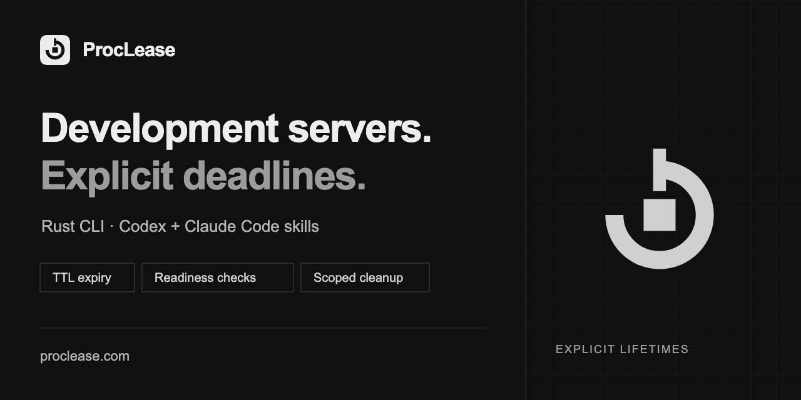

# GitHub discovery metadata

The public repository's About settings and social preview are maintained on
GitHub separately from the website. This page records the intended metadata and
where to update it. It does not establish search rankings or traffic gains.

## Description and topics

Repository description:

> Rust CLI for coding agents: run development servers with explicit TTLs, bounded readiness checks and automatic cleanup. Includes Codex and Claude Code skills.

The topics describe the implementation, purpose and supported hosts:

- Purpose: `ai-agents`, `developer-tools`, `development-server`.
- Process tooling: `cli`, `process-manager`, `process-supervisor`, `rust`.
- Supported agent ecosystem: `agent-skills`, `claude-code`, `codex`, `codex-cli`.

Keep topics tied to shipped behavior and actual integrations. GitHub's maximum
of 20 is a limit, not a target. Default repository search uses the name,
description and topics; README search can be requested with `in:readme`.
See GitHub's [topic guidance](https://docs.github.com/en/repositories/managing-your-repositorys-settings-and-features/customizing-your-repository/classifying-your-repository-with-topics)
and [repository search documentation](https://docs.github.com/en/search-github/searching-on-github/searching-for-repositories).

Edit description/topics in the repository's About settings or with an authorized
GitHub CLI/API session. A Git commit alone does not update these settings.
Retain useful existing topics when adding new ones; avoid unsupported integration,
security, containment or performance claims.

## Repository social preview

The editable [SVG](assets/github-social-preview.svg) and upload
[PNG](assets/github-social-preview.png) are 1280x640 pixels with a solid dark
background. They reuse the website's [lease-ring identity](../website/dist/assets/icon.svg).
The PNG is under GitHub's 1 MB limit and was checked at full and half size.

Upload the PNG under repository **Settings → General → Social preview**.
Committing a replacement does not automatically replace the uploaded image.
GitHub's [preview guidance](https://docs.github.com/en/repositories/managing-your-repositorys-settings-and-features/customizing-your-repository/customizing-your-repositorys-social-media-preview)
describes image requirements and upload steps. Sharing platforms can retain cached
previews after an update.

The website's Open Graph image in `website/dist/assets/social.png` is separate;
website metadata and publication remain documented in the [website README](../website/README.md).

## Verification, 2026-11-09

The repository API matched the description and all eleven topics above. GitHub
reported a custom Open Graph image, and its publicly served 1280x640 PNG was
byte-identical to the reviewed upload and committed PNG. The image was visually
checked at 1280x640 and 640x320. Independent reviews accepted the metadata and
artwork; this maintenance document summarizes their supported choices and the
application checks. External sharing-platform caches and search-ranking changes
were not measured.
